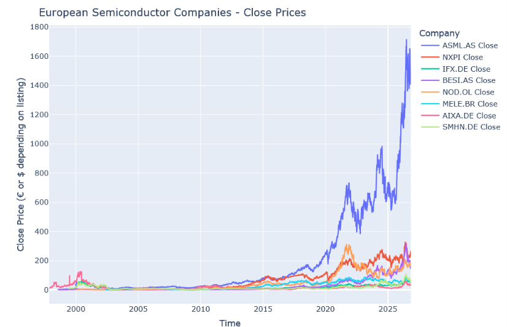

# Tools used
This project was made using Python and Quarto. Quarto is a quite new notebook style ecosystem for data scientists. It was originally built from RMarkdown. It's proven to be a much more modern and flexible tool than many of the alternatives.
For stocks data scrapping, yfinance library was used. For data visualization I've used matplotlib, plotly and seaborn. Each of them provides some uniquely important features. For example plotly has very good interactive plots. For data storage I've used Pandas DataFrames since they are the easiest to use with visualization tools.
For ML and statistical analysis, I've used scipy, statsmodels, XGBoost and sklearn. These all provide modern ML and statistical methods to data analysis, which is especially important in financial analysis. 
# What is it?
The project is a toy-model and example of a stock market analysis of European semiconductor companies stock markets, 
including technical indicator analysis, statistical checks and time series forecasting.

The .html file features all of the output for visualization. It's a large file, so loading/rendering it might take a while depending on your browser.
The .qmd file is the Quarto source file.

# Screenshots

Some screenshots from the working notebook html view:

.png)
.png)
.png)
.png)

